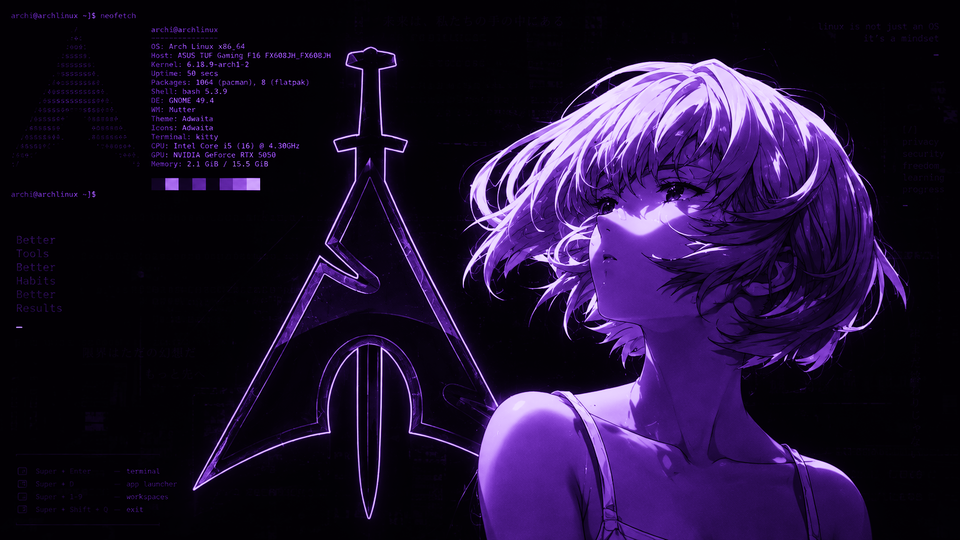

# Omarchy Evangelion Themes

Набор из трёх тем для [Omarchy](https://omarchy.org) по мотивам *Neon Genesis Evangelion*.
Один силуэт, три настроения — красный NERV, фиолетовый EVA-01 и монохромная ночь.

| Тема | Акцент | Иконки | Настроение |
|------|--------|--------|-----------|
| **nerv** | `#ff1f35` красный | Yaru-red | классический терминал NERV, кроваво-красный на чёрном |
| **unit-01** | `#a855f7` фиолетовый | Yaru-purple | цвета Евы-01, фиолет по тёмному |
| **mono-night** | `#c8c8c8` серый | Yaru-gray | тот же силуэт без цвета, строгий монохром |

Все три — тёмные. Каждая содержит `colors.toml` (палитра для omarchy-shell, терминала,
border'ов Hyprland), `icons.theme`, обои (`backgrounds/`) и превью.

## Превью

### nerv


### unit-01


### mono-night


## Установка

Скопируй нужную тему (или все три) в каталог тем Omarchy и выбери её в меню тем:

```bash
git clone https://github.com/Ratmanchik729/omarchy-evangelion.git
cp -r omarchy-evangelion/nerv       ~/.config/omarchy/themes/
cp -r omarchy-evangelion/unit-01    ~/.config/omarchy/themes/
cp -r omarchy-evangelion/mono-night ~/.config/omarchy/themes/
```

Дальше: `Super + Space` → Theme (или `omarchy-theme-menu`) и выбери тему.
Чтобы снести — удали папку из `~/.config/omarchy/themes/`.

## Лицензия

Конфигурация тем — MIT (см. [LICENSE](LICENSE)). Обои сделаны на основе артов и символики
*Neon Genesis Evangelion* (© khara / GAINAX) и выложены как фан-арт для личного
некоммерческого использования; права на оригинальные образы принадлежат правообладателям.
